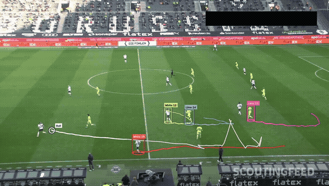
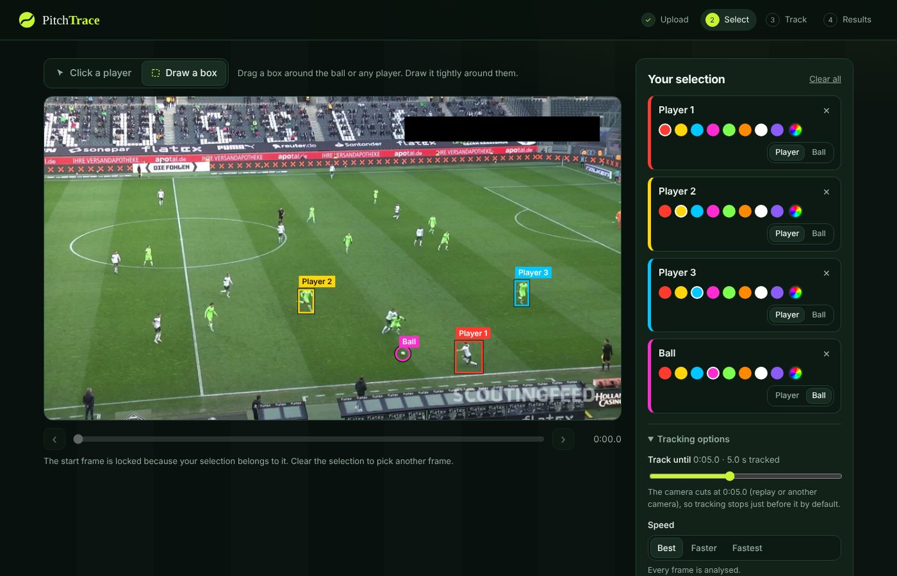
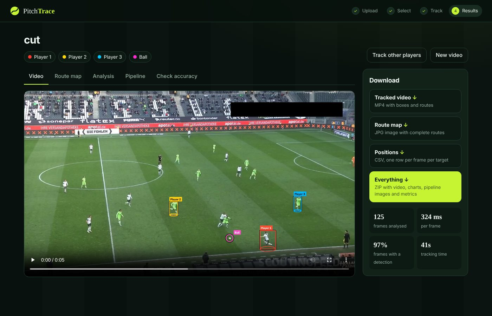
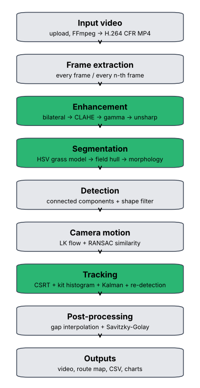

# ⚽ PitchTrace

**Track football players and the ball in match video, with classical computer vision and no deep-learning model.**

Upload a match clip, click the players and the ball you want to follow, and PitchTrace returns the tracked video with every route drawn on it. It also gives you a route map of the whole camera pan, frame-by-frame position data, and an analysis of distance, speed and tracking quality.



<sub>Players from both teams and the ball tracked through a real broadcast clip with a panning camera. One team wears lime-green kits with the same hue as the grass.</sub>

---

## ✨ Features

- **Upload a clip or paste a YouTube link** and choose the start and end time. Only that part is processed.
- **One-click selection.** Players **and the ball** are detected automatically on the chosen frame, so you just click them. You can also draw a box around anything.
- **Robust tracking** through camera pans and zooms, crossings, tackles and occlusions:
  - camera-motion compensation, so routes are in pitch coordinates, not screen coordinates
  - per-player Kalman filter, CSRT tracker and kit-colour model
  - motion tracks for *every* player on the pitch, so team-mates in the same kit are not confused when they cross
  - shirt-colour team checks, so a box never jumps to a player of the other team
- **Whole-clip ball path.** Ball candidates are collected on every frame, then dynamic programming (Viterbi) picks the most plausible trajectory, so a white boot or sock can't "steal" the ball.
- **Analysis:** distance covered, average and top speed, a stitched route map, a tracking-quality report, and a CSV of every position.
- **Everything downloadable** as one ZIP: tracked video, route map, CSV, charts, intermediate pipeline images and `metrics.json`.

| Select players and the ball | Results and analysis |
|---|---|
|  |  |

---

## 🚀 Quick start

### Requirements
- **Python 3.10 – 3.12**
- **FFmpeg** on your PATH: `winget install Gyan.FFmpeg` (Windows), `brew install ffmpeg` (macOS) or `sudo apt install ffmpeg` (Linux)

### Run locally

**Windows (cmd)**
```cmd
git clone https://github.com/<your-username>/pitchtrace.git
cd pitchtrace
python -m venv venv
venv\Scripts\activate
python -m pip install -r requirements.txt
python app.py
```

**macOS / Linux**
```bash
git clone https://github.com/<your-username>/pitchtrace.git
cd pitchtrace
python3 -m venv venv
source venv/bin/activate
pip install -r requirements.txt
python app.py
```

Then open **http://localhost:7860**.

### Run with Docker
```bash
docker build -t pitchtrace .
docker run -p 7860:7860 pitchtrace
```

### Share it from your computer
To give someone a temporary public link while the app runs on your machine:
```bash
cloudflared tunnel --url http://localhost:7860
```

---

## 🖱️ How to use it

1. **Video:** upload a file (MP4, MOV, AVI, MKV, WebM) or paste a YouTube link, then set the start and end time.
2. **Select:** slide to a clear frame. Players are outlined and the ball gets a yellow **"Ball?"** ring. Click each target, then give it a name and a route colour. If the ball is at a player's feet, draw a box around it instead.
3. **Track:** choose a speed setting (*Best* = every frame, *Faster*, *Fastest*) and start. You can leave the page and come back with the same link.
4. **Results:** watch the tracked video, explore the route map and charts, check accuracy, and download everything.

> **Tip:** a 30 s clip with 10 targets takes about 4–5 minutes on a 2-core CPU. Use shorter clips, fewer targets or the *Faster* setting for quicker results.

---

## 🧠 How it works



Every frame goes through **enhance → segment → detect → estimate camera motion → track**.

| Stage | Method |
|---|---|
| Enhancement | Bilateral denoising, CLAHE on Lab lightness, adaptive gamma, unsharp masking |
| Segmentation | Grass colour learned from each video (HSV peak and Lab Mahalanobis model), field boundary, pitch-line removal, morphology, perspective check |
| Camera motion | Shi–Tomasi corners, Lucas–Kanade optical flow and a RANSAC similarity transform, chained over time |
| Player tracking | CSRT, kit-colour histogram and Kalman filter. Crowd handling uses motion tracks for all players and a shirt-colour team check |
| Ball tracking | Template matching and ball-likeness scoring on every frame, then a whole-clip Viterbi path with a 30 m/s speed limit |
| Outputs | Smoothed routes, stitched route map, speed and distance charts, per-target quality metrics |

Each stage, with its parameters and the reasons behind them, is explained in **[docs/METHOD.md](docs/METHOD.md)**.

---

## 📊 Results

Measured on a real 30 s Bundesliga broadcast clip (1080p, 25 fps, panning and zooming camera), with 9 players and the ball:

| Check | Result |
|---|---|
| Player box on a player of the correct team | **91 %** of sampled frames |
| Player box on the other team (identity swap) | **2.3 %**, brief overlaps during tackles |
| Ball box on the ball | **about 70 %** of half-second samples, with a position on every frame |
| Processing speed | about 0.36 s per frame with 10 targets on 2 vCPUs |

On synthetic test clips with known positions, all players stay at 100 % with a median error of 1–2 px. On semi-real stress clips (real broadcast background and sprites, with same-kit crossings and side-by-side runs) there are no identity switches at full frame rate. Details are in [docs/METHOD.md](docs/METHOD.md#3-results).

---

## 🗂️ Project structure

```
app.py                 Flask web server and REST API
tracker/
  video_io.py          FFmpeg conversion, frame access, video writer
  shots.py             camera-cut and static-graphics detection
  enhancement.py       4-stage image enhancement and quality metrics
  segmentation.py      grass model, field region, player and ball detection
  camera_motion.py     camera-motion compensation (optical flow and RANSAC)
  tracking.py          multi-target tracker (CSRT, Kalman, crowd handling, ball model)
  ballpath.py          whole-clip ball trajectory (Viterbi)
  render.py            route and box drawing, stitched route map
  analysis.py          charts and pipeline images
  pipeline.py          end-to-end job: all stages, post-processing, outputs
static/                web front end (HTML, CSS, JavaScript)
tools/                 test-clip generators and ground-truth evaluators
docs/                  method write-up, figures, sample frames and outputs
Dockerfile, requirements.txt
```

### Testing
```bash
# synthetic clip with known positions
python tools/make_synthetic_clip.py synth.mp4 synth_gt.json
python tools/evaluate_synthetic.py synth.mp4 synth_gt.json

# semi-real stress clip (real broadcast background and sprites); optional seed for variants
python tools/make_semireal_clip.py semi.mp4 semi_gt.json [seed]
python tools/evaluate_semireal.py semi.mp4 semi_gt.json [frame_step]
```

### Configuration
Optional environment variables:

| Variable | Default | Meaning |
|---|---|---|
| `PORT` | 7860 | Web server port |
| `MAX_UPLOAD_MB` | 500 | Largest upload |
| `MAX_TRACK_SECONDS` | 120 | Longest range tracked per run |
| `MAX_CLIP_SECONDS` | 300 | Longest part cut from an upload or YouTube link |
| `JOB_TTL_HOURS` | 24 | Uploaded videos and results are deleted after this time |
| `WORKERS` | 1 | Tracking jobs processed at the same time |

---

## ⚠️ Limitations

- **Not real-time:** about 3 frames per second on 2 CPU cores.
- **Long full occlusions:** two team-mates in identical kits that overlap for a long time can still be mixed up.
- **Lofted balls:** a ball high in the air is small and blurred, so its path is interpolated, and ball speed is unreliable.
- **Approximate distances:** there is no pitch homography; the scale comes from an assumed player height.
- **YouTube links** often fail on cloud servers because YouTube blocks them. Uploading a file always works.

Ideas for the future: pitch homography for real-metre top-down maps, jersey-number recognition, a 3-D ball-flight model, and GPU acceleration.

---

## 🙏 Credits

- **Test footage:** `08fd33_4.mp4` from the [DFL – Bundesliga Data Shootout](https://www.kaggle.com/competitions/dfl-bundesliga-data-shootout) dataset (Kaggle, Deutsche Fußball Liga), Borussia Mönchengladbach vs VfL Wolfsburg. It is used for demonstration only and is **not included** in this repository. The sample frames and preview images in `docs/` are taken from that clip.
- **Methods:** Shi–Tomasi corners, Lucas–Kanade optical flow, RANSAC (Fischler and Bolles), CSRT (Lukežič et al., CVPR 2017), the Kalman filter, CLAHE (Zuiderveld), the bilateral filter (Tomasi and Manduchi), Viterbi dynamic programming.
- **Libraries:** OpenCV, NumPy, SciPy, Matplotlib, Flask, FFmpeg, yt-dlp.

## 📄 License

The code is released under the [MIT License](LICENSE). The match footage and images derived from it belong to their respective rights holders and are not covered by this license.
