# PitchTrace: method and evaluation

This document explains how PitchTrace works, stage by stage, and how well it performs. For installation and usage, see the [README](../README.md).

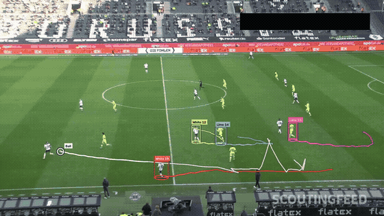

---

## Contents
1. [What the website does](#1-what-the-website-does)
2. [How the process works](#2-how-the-process-works)
   - [2.1 Video preparation](#21-video-preparation)
   - [2.2 Image enhancement pipeline](#22-image-enhancement-pipeline)
   - [2.3 Segmentation pipeline](#23-segmentation-pipeline)
   - [2.4 Camera-motion compensation](#24-camera-motion-compensation)
   - [2.5 Player and ball tracking](#25-player-and-ball-tracking)
   - [2.6 Post-processing and outputs](#26-post-processing-and-outputs)
   - [2.7 Real-broadcast problems and how they are handled](#27-real-broadcast-problems-and-how-they-are-handled)
3. [Results](#3-results)
4. [Limitations and future work](#4-limitations-and-future-work)
5. [Sources and credits](#5-sources-and-credits)

---

## 1. What the website does

| Step | What you do | What happens |
|---|---|---|
| **1 · Video** | **Upload a video** (MP4, MOV, AVI, MKV, WebM) **or paste a YouTube link**, then choose the **start and end time** of the part you want, using a preview player, a two-handle slider, typed times or "Use current time" | Only that part is kept: cut from the upload, or downloaded from YouTube at up to 1080p. It is converted to a standard format and scanned for camera cuts and burnt-in graphics |
| **2 · Select** | Slide to a clear frame, then click the players and the ball | Players **and the ball** on that frame are detected automatically and outlined, so one click selects one. You can still draw a box around anything |
| | Give each target a name, a **route colour** and a type (player / ball) | Up to 12 targets per run |
| | Choose the range, speed and route style | "Track until" stops before the next camera cut by default |
| **3 · Track** | Wait, or leave the page and come back with the same link | Progress bar with the current stage and time left |
| **4 · Results** | View and download | Tracked video, route map, CSV, analysis charts, pipeline images, accuracy check, ZIP of everything |

**Choosing the part of the video**
- **Upload a video:** after choosing the file, a preview player opens. Set **Start** and **End** by typing (`1:30`, `0:01:30`), by dragging the two slider handles, or by pausing the video and pressing **Use current time**. Only the selected part is processed. You can choose up to 5 minutes, and up to 2 minutes is tracked per run.
- **YouTube link:** paste the link and press **Check link**. The title, channel and length are shown, with the YouTube player for finding the moment, and you choose start and end the same way. The server downloads **only that part** (using `yt-dlp`, at up to 1080p). The link and times are saved in `metrics.json` and shown on the results page, so the source can be credited.
- Times on the Select screen count from the start of the chosen part. Hovering over the time shows the matching time in the original video.

**How you select targets**
- **Click to select:** the frame runs through the enhancement and segmentation pipeline (section 2.3). Every detected player gets a dashed outline and the ball gets a yellow **"Ball?"** ring. Hovering highlights one and clicking selects it. The ball is only suggested when the detector is confident (section 2.3, *Ball detection*). If it is not found, for example because it is touching a boot, the hint says so.
- **Draw a box:** drag a rectangle around anything. Use this for the ball when it was not found, for a goalkeeper or referee, or for a player that auto-detection missed. A small box is set to type *Ball* automatically, and the tracker tightens it onto the ball.
- The start frame is locked while targets are selected, because their boxes belong to that frame.

| Selecting targets | Results page |
|---|---|
| 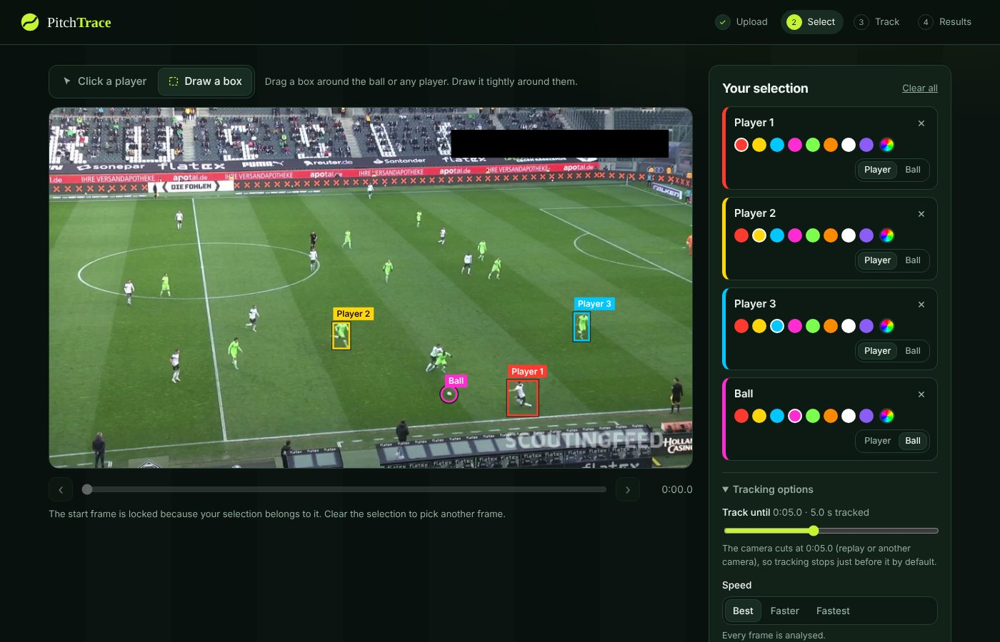 | 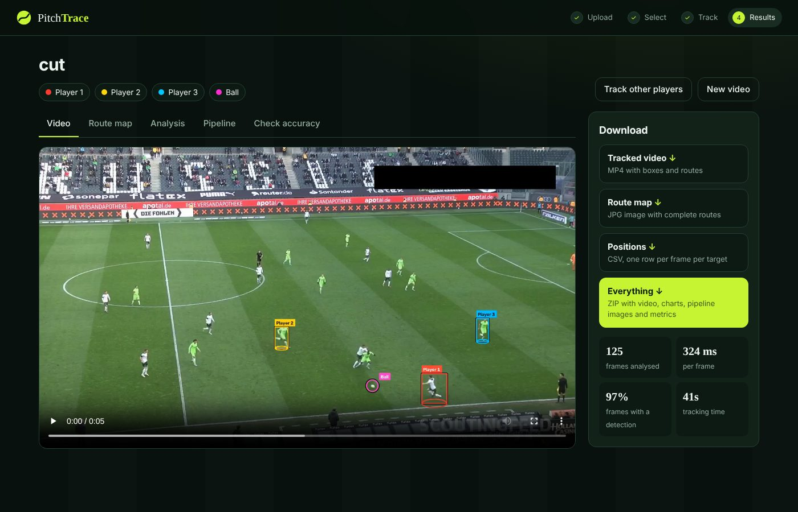 |

---

## 2. How the process works

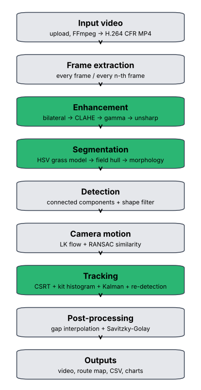

Every frame goes through the same chain:
**enhance → segment → detect → estimate camera motion → track each target**.

After the last frame, the routes are cleaned up and every output is drawn. Processing runs at 960 px width for speed. Final drawing uses the original resolution.

### 2.1 Video preparation
*Code: `tracker/video_io.py`, `tracker/shots.py`*

1. **Getting the video:** paste a YouTube link into the website and choose a start and end time. The server uses `yt-dlp` to download only that section, choosing the best stream up to 1080p, and cuts at exact keyframes. You can also upload your own file and choose the part to keep. The source link and time range are stored with the results.
2. **Format conversion and trimming:** FFmpeg cuts the selected time range (`-ss start -t length`) and re-encodes it to **H.264, constant frame rate, at most 1080p, no audio**. YouTube files often use VP9/AV1 codecs or a variable frame rate, which break frame-accurate seeking in OpenCV. After conversion, frame *n* is always at time *n / fps*.
3. **Frame extraction:** frames are decoded one after another with OpenCV `VideoCapture` from the chosen start frame.
4. **Frame sampling strategy:** you choose between three settings.
   - **Best:** every frame.
   - **Faster:** every 2nd frame (about 2× faster).
   - **Fastest:** every 3rd frame (about 3× faster).

   A larger step means bigger movement between processed frames, so the motion gates in the tracker are scaled by the effective frame rate.
5. **Shot scan:** right after upload, a background pass looks for camera cuts and static graphics (section 2.7).

Sample extracted frames are saved for every run (`samples/`). Examples are in [`docs/sample_input_frames`](sample_input_frames).

### 2.2 Image enhancement pipeline
*Code: `tracker/enhancement.py`*

Broadcast footage suffers from compression noise, uneven stadium lighting (half the pitch in shadow), a flat or washed-out tone curve, and motion blur from fast pans. Four stages address these in order:

| # | Stage | Problem addressed | Method and parameters |
|---|---|---|---|
| 1 | **Noise reduction** | compression and sensor noise | **Bilateral filter** (d = 5, σ_space = 5). It is edge-preserving, so player outlines stay sharp. σ_colour is set from the measured noise level (Immerkær's fast noise estimator). The stage is skipped when noise σ < 1.5. |
| 2 | **Local contrast** | shadows and uneven floodlights | **CLAHE** on the L channel of CIE-Lab (clip limit 2.0, 8×8 tiles). Only lightness changes, so kit colours used by the tracker are not shifted. |
| 3 | **Gamma correction** | frames that are too dark or too bright | output = input^γ. The exact correction would be γ* = ln(0.5) / ln(μ), where μ is the mean brightness. A gentle partial correction γ = √γ*, clipped to [0.7, 1.4], is applied. |
| 4 | **Sharpening** | motion blur | **Unsharp masking**: I + a·(I − G_σ * I), with σ = 1.2. The amount *a* (0.4 to 1.2) grows as the sharpness (variance of the Laplacian) falls. |

All parameters are estimated **once per clip** from the start frame and then kept fixed. Re-estimating every frame would make colours flicker, which would hurt the colour-histogram tracker.

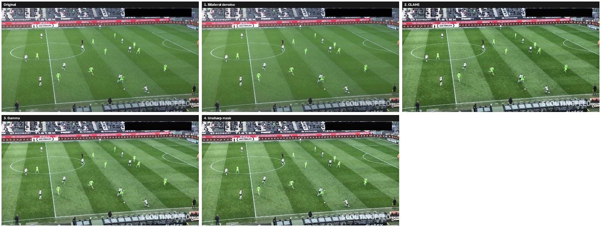
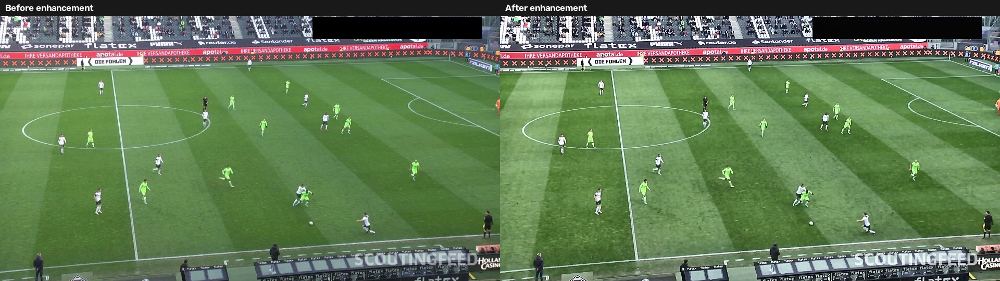

**Measured effect.** Each run measures these on 8 sample frames, original vs enhanced:
- brightness
- RMS contrast
- entropy
- sharpness (Laplacian variance)
- noise level
- **number of players detected per frame**

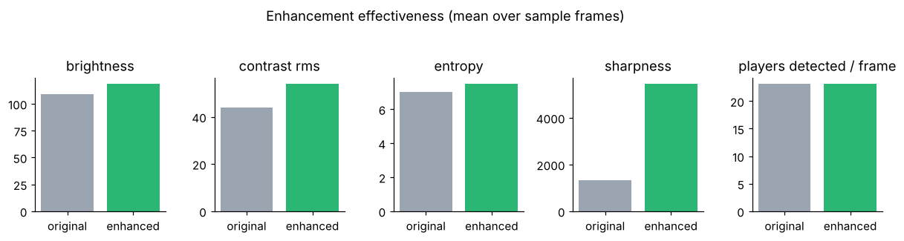

### 2.3 Segmentation pipeline
*Code: `tracker/segmentation.py`*

The aim is to separate players (and the ball) from the pitch. The key observation is that **the grass is the largest single-coloured region in the frame**, so the system learns the grass colour from each video instead of hard-coding "green".

**Step 1: Candidate grass pixels (HSV hue histogram).** Frames are converted to HSV. A hue histogram is built from saturated pixels (S > 40, V > 30). The highest peak in the green band (H ∈ [25, 95] on OpenCV's 0–179 scale) is the grass. The interval around the peak where the histogram stays above 8 % of the peak gives the candidate grass pixels.

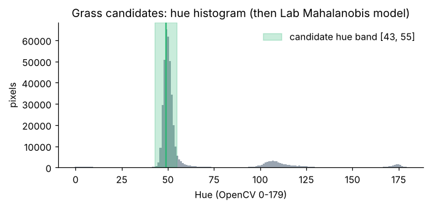

**Step 2: Statistical grass colour model (Lab + Mahalanobis distance).** On real footage hue alone fails. In the test match, one team's lime-green kits have **exactly the grass hue** (H ≈ 50), but they are much brighter (V ≈ 200 vs ≈ 130). The candidate pixels are therefore modelled as a 3-D Gaussian in CIE-Lab, with mean **μ** and covariance **Σ**. A pixel with colour **c** is grass when

  **d²(c) = (c − μ)ᵀ Σ⁻¹ (c − μ) < T**

- The model is fitted robustly. The extreme 2 % at each end is trimmed, then there are two re-weighting passes, so the minority of kit pixels that share the grass hue is rejected.
- **T** is data-driven: 1.6 × the 97th percentile of the training distances.
- For speed, the test is precomputed into a **64×64×64 Lab look-up table**, so it costs one table lookup per pixel.
- The model is **refreshed every 2 seconds** with pixels from newer frames, so shadows and lighting changes during camera pans are learnt.

**Step 3: Field region.** The grass mask is closed with a large elliptical kernel. For every image column, the top-most and bottom-most rows of the main grass region give the field boundary. Both boundary profiles are then **median-filtered across columns** (window = W/12). The narrow notch made by a player standing on the touchline is removed, while the real edge of the grass is followed. This excludes the crowd, advertising boards and dugouts. A convex hull, used in an earlier version, wrongly included the boards.

**Step 4: Foreground.** Foreground = field ∧ ¬grass. This leaves players, the ball and pitch markings.

**Step 5: Pitch-line removal.** White pixels (S < 80, V > 160) that disappear under a 7×7 morphological opening are *thin*. Thin connected components longer than 5 % of the frame width are pitch markings and are removed. Short thin parts, such as white shorts and socks, are kept.

**Step 6: Morphology.** An **opening** (3×3 ellipse) removes noise. Then a **closing** (3×7 vertical rectangle) re-joins the torso, shorts and legs of the same player.

**Step 7: Connected components and shape filter.** A blob is a player when all of these hold:
- height ≥ 1.7 % of the frame height
- 0.8 ≤ h/w ≤ 6
- fill ratio (area / box area) ≥ 0.18

Wide blobs, where a player has merged with a touchline strip or a shadow, get a vertical opening that keeps only upright bodies.

**Step 8: Perspective check.** Players further from the camera look smaller. A line **h = a·y_feet + b** is fitted robustly to the detections. Blobs whose height is implausible for their position are rejected (for example, small fragments of the advertising boards).

**Ball candidates.** These are small (area set from the size of the user's ball box), roughly round (aspect 0.4–2.5), compact (fill ≥ 0.35) blobs taken from the foreground before the opening, so the tiny ball is not erased. Short motion-blurred streaks (a fast pass) are accepted as well.

**Ball detection (Select screen).** To suggest the ball without any user input, each small non-grass blob in the field is scored from 0 to 1 by:
- **size:** the expected ball diameter comes from the perspective line *h = a·y + b* fitted to the detected players. The ball is about 0.2 × the height of a player standing at the same image row, so a ball near the camera is allowed to be bigger than one far away.
- **shape:** roundness (a disk fills ~78 % of its box) and aspect ratio.
- **colour:** bright and unsaturated, measured on the blob's brightest half so the dark shadow under the ball does not count against it.
- **contrast:** brighter than the ring of grass around it.

Blobs in the upper 80 % of a player box (heads, shirts, socks) are rejected. Only suggestions scoring ≥ 0.6 are shown. On the real sample frames the ball was the top suggestion whenever it was in the open, and no suggestion was made on a frame where it was not visible.

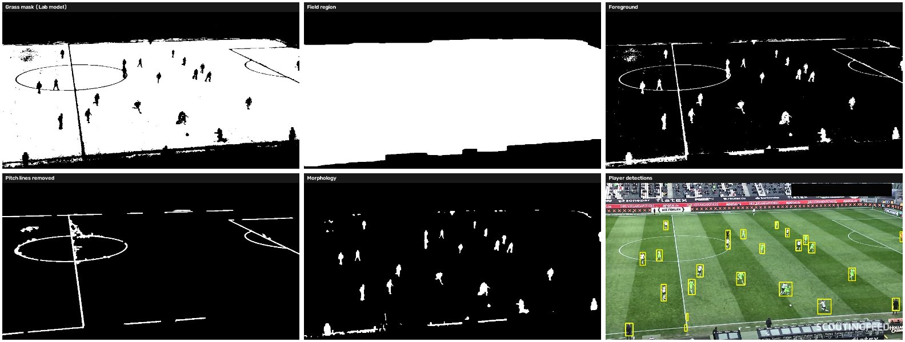

| Segmented players (foreground pixels only) | Selected targets: crop and segmented crop |
|---|---|
| 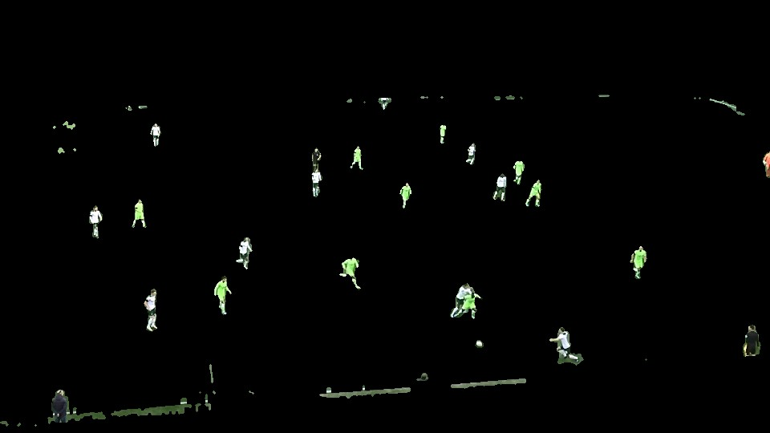 | 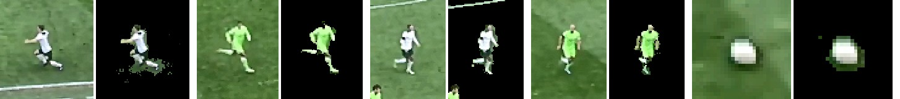 |

**Segmentation challenges in football video:**
- kits in grass-like colours (handled by the Lab model)
- white kits touching white lines (handled by line removal)
- players merging when they overlap
- shadows splitting the pitch into two brightness levels (handled by model refresh)
- advertising boards and the crowd (handled by the field region)
- tiny far-away players
- motion blur

### 2.4 Camera-motion compensation
*Code: `tracker/camera_motion.py`*

A broadcast camera pans, tilts and zooms all the time, so a player's pixel position mixes their own movement with the camera's. Without compensation, a route would show the camera's movement instead of the player's.

1. **Shi–Tomasi corners** are detected on the previous frame. Two areas are masked out:
   - tracked players, because they move by themselves
   - burnt-in graphics such as the score bug, logo and watermark, because they never move
2. **Pyramidal Lucas–Kanade optical flow** finds those corners in the current frame.
3. A similarity transform is fitted with **RANSAC**, which rejects points that still move by themselves (other players, animated LED boards). Only **zoom** (uniform scale) and **pan/tilt** (translation) are kept. Rotation is dropped because broadcast cameras do not roll, and it would otherwise build up as drift. The translation is re-fitted on the RANSAC inliers.
4. Transforms are chained: **M_t = F_t · M_(t−1)**, where M_t maps the *reference frame* (the first tracked frame) to frame *t*.

Every route point is stored in reference coordinates and mapped back into each frame with M_t when drawing. Routes therefore stay attached to the pitch while the camera moves. The **route map** warps sampled frames into the reference frame as well. Pitch lines that line up across the whole pan, as in the image below, show that the camera model is correct.

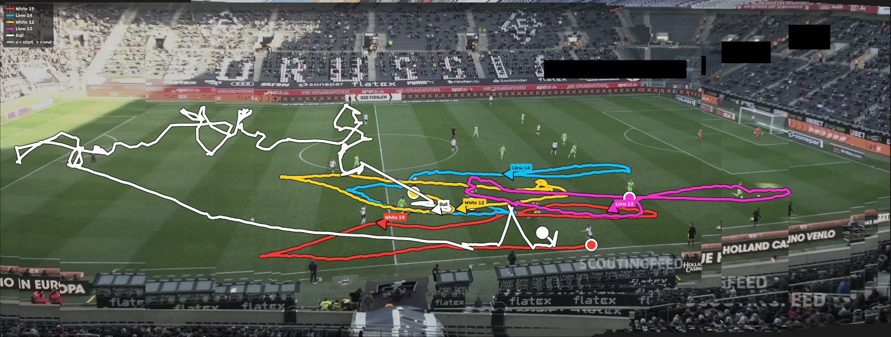

### 2.5 Player and ball tracking
*Code: `tracker/tracking.py`*

Each selected target has its own tracker, which combines four ideas.

| Component | Role |
|---|---|
| **CSRT tracker** (OpenCV: discriminative correlation filter with channel and spatial reliability) | Proposes the target's box in each new frame from its appearance |
| **Kit appearance model**: a 16×8 Hue–Saturation histogram computed only on non-grass pixels of the box | Checks every proposal with the Bhattacharyya similarity, **sim = 1 − d_B(h_model, h_box)**. The model adapts slowly (5 % per frame) and stays anchored to the first appearance. If a kit is mostly grass-coloured, the whole box is used. |
| **Kalman filter** (constant velocity, state [x, y, vx, vy], in camera-compensated coordinates) | Predicts where the target should be, rejects impossible jumps, and bridges occlusions |
| **Re-detection** from the segmentation blobs | When CSRT drifts or fails, nearby blobs are scored by 0.6·appearance + 0.3·distance + 0.1·size, and CSRT is restarted on the best one |

The thresholds adapt to each target. The tracker keeps a running average of the target's own similarity score (its "base"), and accepts a box when it reaches 0.75 × base. This works for kits that match well (white) and kits that match less well (lime on grass).

**Frame-to-frame localisation:**
1. The Kalman filter predicts the position, which is mapped into the current frame with the camera transform.
2. CSRT proposes a box. It is accepted if the appearance is good, the box is within the motion gate around the prediction, and its size is plausible.
3. Otherwise the target is re-detected from segmentation blobs near the prediction. The search radius grows the longer the target stays unseen.
4. Otherwise the target is marked **occluded** and follows the Kalman prediction. After 1.5 s unseen it becomes **lost**, and the whole frame is searched for a **clear, unambiguous** appearance match: the best match must beat the second best, so a team-mate in the same kit is not picked.

**Crossings and occlusion between team-mates.** Two players in identical kits cannot be told apart by colour, so the tracker must know where *both* players are expected to be, not only its own target.
- **Motion tracks for every player.** Every detected player blob, selected or not, gets a light-weight motion track. Blobs are matched to tracks with the Hungarian algorithm in camera-compensated coordinates. A merged blob (two players) or a half-hidden player does not update a track, so both players keep the velocity they had before they met.
- **Crowd mode.** When another player comes within about one body length, or the target's blob merges with another, the target's velocity is frozen at the value fitted over the last 0.6 s on its own. It is limited to a physically possible ~9 m/s, with the pixel scale from the player's height. The target then follows this constant-velocity path. Each neighbour is followed on *its own* extrapolated path, and a neighbour's track update is ignored when it jumps off that path, because tracks can swap when players merge.
- **Accepting a measurement.** A box from CSRT or from the blobs is accepted only if it is close to the target's path **and** clearly closer to it than to every same-kit neighbour's path (distance to own path < 0.6 × distance to neighbour). An opponent in a different kit is told apart by colour instead. While the players overlap, every candidate is ambiguous and the target coasts rather than guessing.
- **After the encounter**, if the player turned while hidden, the one player-sized blob near him that no other player's established track accounts for is taken, but only if it is the *only* such blob and he is not hidden inside a merged blob.
- **Lost targets** are searched only as far as a player can run in the time they were unseen (about 9 m/s), and nearer candidates are preferred. The whole frame is searched only after a camera cut. Previously a lost target could be re-identified on any team-mate anywhere in the frame.
- **Team colour.** Each player's shirt colour (median CIE-Lab chroma of the upper body) is stored. A candidate in a crowd, or when re-finding a lost player, must have a measurable shirt of the same colour. A box whose shirt colour cannot be measured is not accepted there, so a white player can no longer be taken for a lime one or vice versa.
- **One player, right size.** Re-detection only accepts a blob the size of one player: height 0.55–1.5× and width 0.35–1.7× the player's expected size (height is the stable measure, width changes with the running pose). Two merged players in a duel are about twice as wide or tall and are rejected. The expected size follows the camera zoom, and adapts only to measurements close to it, so a box can no longer grow onto two players. CSRT's own scale estimate is used only when it stays close to the player's size.
- Targets that are already confirmed claim their blobs first, so two targets cannot take the same player.

**The ball** is tiny and fast, and it often leaves the pitch plane in the air, which is where CSRT is weak, so the ball has its own measurement model:
- **Fixed size and a template.** The user's ball box is tightened onto the ball, and its size is then kept fixed (earlier versions let the size drift until whole players passed as "the ball"). A grey-level template of the ball with a ring of grass around it is stored.
- **Candidates** come from ball-candidate blobs (including motion-blur streaks) and from peaks of **normalised cross-correlation** with the template. The template also finds the ball when it touches a boot and is part of the player's blob.
- **Weak vs strong.** A match on or touching a player could be a sock or a boot. It is "weak": it keeps the ball at the player's feet, but it never beats a clear, isolated ball, and it widens the search.
- **Passes.** A candidate far from the prediction must be seen on two consecutive frames, and its motion must trace back to where the ball was last measured. A passed ball moves away from the passer; a white spot on the pitch does not. Ball speed is capped at ~30 m/s.
- **When unseen,** the search radius grows with time up to the whole pitch, and the area around the last known position is searched too (the ball is often stopped by a player).
- **No template drift.** The template is not adapted, because a template that learns from its own matches slowly turns into a grass template after a few wrong ones. Mediocre matches on open grass are rejected outright, and a ball seen only as weak matches for over a second counts as unseen.

**Whole-clip ball path** (`tracker/ballpath.py`). The frame-by-frame answers above are not used directly. At the moment of a kick, the kicker's boot or a white sock can look more like the ball than the blurred ball itself, and a tracker that picks it once never comes back. Since the whole video is processed before anything is drawn, the final ball position is chosen with hindsight:
1. On every frame, up to 10 ball candidates are collected (ball-likeness of blobs and template correlation), in camera-compensated coordinates.
2. Dynamic programming (Viterbi) finds the cheapest path through them. Each candidate costs 1 − score, each frame with no ball on the path costs 0.42, and moving between candidates costs more the closer it gets to the 30 m/s limit (it is impossible above it). The path may restart after a camera cut or a long loss, at a fixed penalty.
3. The path starts at the user's ball, and frames between path points are interpolated (status *predicted*), so the ball has a position on every frame of a camera shot.

On the real 30 s Bundesliga clip (`08fd33_4.mp4`), the frame-by-frame tracker lost the ball at 4.5 s, after a back-pass to the keeper, and then followed a patch of grass for the rest of the clip. With the whole-clip path, the box is on the ball in about 70 % of the half-second samples (before: about 13 %). The remaining misses are a long goal kick high in the air and moments where the ball is hidden at players' feet.

Each frame gets a status for every target: `tracked`, `redetected`, `predicted` (occluded), or `lost`.

### 2.6 Post-processing and outputs
*Code: `tracker/pipeline.py`, `tracker/render.py`, `tracker/analysis.py`*

- **Route point:** the feet (bottom centre of the box) for players and the centre for the ball, stored in camera-compensated coordinates.
- **Gap filling:** gaps of up to 3 s between two confirmed positions in the same shot are filled by linear interpolation. Longer gaps leave the route broken.
- **Smoothing:** **Savitzky–Golay** filtering (2nd order; window 0.4 s for players and 0.2 s for the ball) on each continuous segment. This removes jitter while keeping sharp turns.
- **Drawing:** routes have a dark outline and older parts are faded. Boxes are solid when the target is measured and dashed when it is occluded, with a name tag and a ground ellipse. You can show the full route or only the last 3 seconds.
- **Distance and speed (approximate):** the scale comes from player height (assumed 1.8 m, median detected height). Speed is smoothed over 1 s.

**Downloads:**

| File | Content |
|---|---|
| `tracked.mp4` | Browser-playable H.264 video with boxes and routes |
| `route_map.jpg` | Stitched view of the shot with every complete route, start (○) and end (▶) |
| `tracks.csv` | For each frame and target: frame number, time, status, box, image point, route point in reference coordinates, whether the point is on the route, confidence |
| `metrics.json` | Video properties, settings, enhancement and segmentation parameters, enhancement evaluation, processing time per stage, per-target consistency, re-detections, longest gap, confidence, distance and speed, camera cuts |
| `charts/` | Processing time per frame, detection-consistency timeline, confidence over time, speed, enhancement comparison, flowchart |
| `stages/` | All enhancement and segmentation intermediate images, target crops, tracking-progression strip |
| `samples/` | Sample extracted frames |
| `spot/` + `verification.json` | 12 sampled result frames, plus your ✓/✗ answers from the accuracy check |

**Accuracy on real footage.** Real broadcasts have no ground truth. The *Check accuracy* tab shows 12 evenly spaced result frames, and for each target you mark ✓ (box on the correct player) or ✗. This gives a tracking accuracy that a person has checked, and it is saved into the ZIP.

### 2.7 Real-broadcast problems and how they are handled

| Problem in real recordings | Solution |
|---|---|
| Kits with the same hue as the grass (lime, neon green) | Lab Mahalanobis grass model (2.3, step 2) |
| Players touching white pitch lines | Removal of long thin white structures (2.3, step 5) |
| Advertising boards, crowd and dugouts | Field boundary from median-filtered grass edges (2.3, step 3), plus the perspective check |
| Players merged with touchline strips or shadows | Vertical opening on wide blobs (2.3, step 7) |
| Lighting changes and shadows during pans | Grass model refreshed every 2 s; CLAHE |
| Camera pan and zoom | LK optical flow + RANSAC similarity; routes in reference coordinates (2.4) |
| Score bug, channel logo, watermark | **Static-overlay detection**: pixels whose intensity barely changes (σ < 3) over ~60 frames sampled across the clip, near edges, are graphics. They are excluded from camera-motion features and from detection. A tripod recording, where everything is static, is detected and the mask is not used. |
| Animated LED advertising boards | Outside the field region; RANSAC rejects their motion |
| **Camera cuts** (replays, close-ups, other cameras) | **Cut detection**: a 32×8 HS histogram for every frame. A cut is declared when the Bhattacharyya distance between consecutive frames is > 0.35 and more than 4× the recent median. Tracking stops before the next cut by default. If you track past a cut, routes are split, camera chaining restarts, and targets must be re-identified with an unambiguous appearance match. |
| Team-mates in the same kit crossing or running shoulder to shoulder | Motion tracks for every player + crowd mode: accept only measurements clearly closer to the target's own path than to any neighbour's (2.5) |
| Ball at a player's feet, fast passes | Template matching, weak/strong measurements, two-frame confirmation with trace-back (2.5) |
| Mostly green goalkeeper kits | The appearance model falls back to the whole box |
| Ball in the air | Shows as a sharp "Λ" in the image-plane route, which is physically correct for a lofted pass. A 3-D ball height is not modelled. |

---

## 3. Results

### Real match: Borussia Mönchengladbach vs VfL Wolfsburg (broadcast tactical camera)
Clip `08fd33_4.mp4` from the DFL – Bundesliga Data Shootout dataset: 1920×1080, 25 fps, 750 frames (30 s), with a panning and zooming camera, a static watermark and a black overlay box. One team wears lime-green kits with the same hue as the grass; the other wears white, close to the white pitch lines.

Nine players (both teams, including a white and a lime player in a duel at the start) and the ball were tracked over every frame. The tracker's own status flags ("tracked", "predicted") say nothing about whether a box is on the *right* object, so the results below were checked against the video itself:

| Check (every 5th frame, all 9 players) | Earlier version | Current version |
|---|---|---|
| Box on a player of the correct team | 81 % | **91 %** |
| Box on a player of the **other** team (identity swap) | 5.2 % | **2.3 %** (brief overlaps during tackles) |
| Box on no player (lost, coasting) | 13.7 % | **6.5 %** |

| Ball (checked visually every 0.5 s) | Earlier version | Current version |
|---|---|---|
| Box on the ball | about 13 % (lost after a back-pass at 4.5 s and stayed on a patch of grass) | **about 70 %**, with a position on every frame |

Second by second, no player's box stays on the other team's kit for more than a moment. The remaining ball misses are a goal kick high in the air (12–17 s) and moments where the ball is hidden at players' feet (21–27 s), where its position is interpolated.

**Processing time:** 358 ms per frame with 10 targets (9 players and the ball) on 2 vCPUs, so about 4.5 minutes for this 30 s clip. The breakdown is:
- enhancement 18 ms
- segmentation 23 ms
- camera motion 12 ms
- tracking 305 ms (dominated by one CSRT tracker per player)

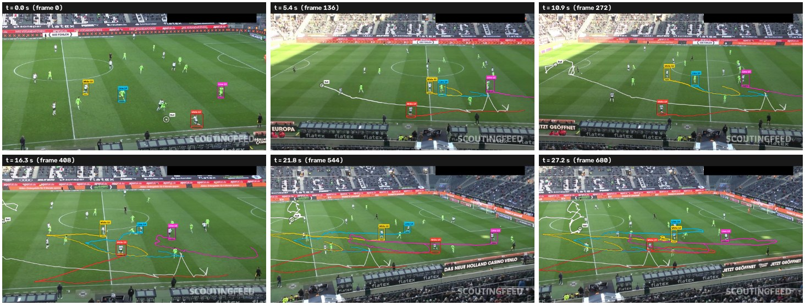
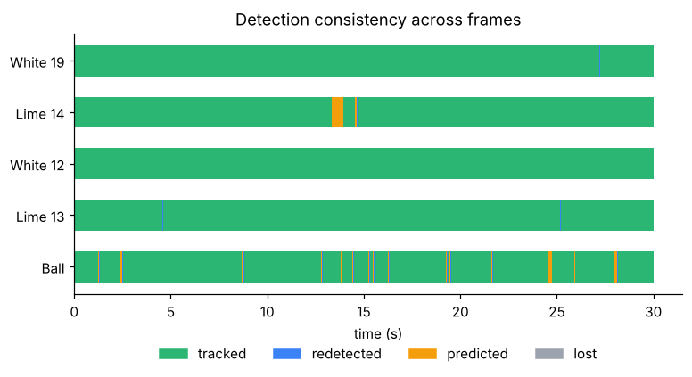
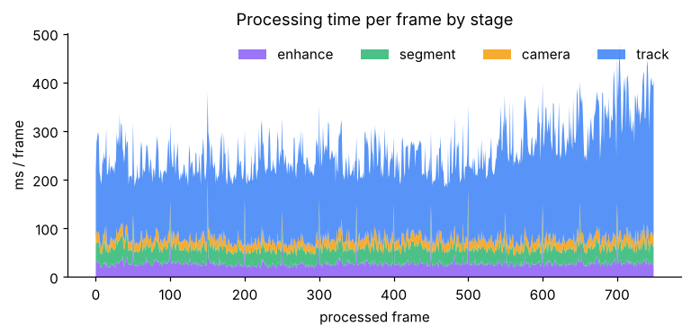

**Camera-cut test.** A clip was built from the same match with a cut to a close-up and back. Both cuts were found exactly (frames 125 and 175), routes were split there, and the website stopped tracking before the first cut by default.

### Known-answer test with ground truth
`tools/make_synthetic_clip.py` generates a clip with known positions. It includes camera pan and zoom, two teams, two same-team crossings and a ball. `tools/evaluate_synthetic.py` measures centre error against the ground truth:

| Target | Median error | 90th percentile | Success (error < 20 px) |
|---|---|---|---|
| Red 1 | 1.3 px | 2.3 px | 100 % |
| Blue 2 (crosses Red 1) | 1.1 px | 2.3 px | 100 % |
| Red 5 (crosses a team-mate) | 1.6 px | 6.5 px | 100 % |
| Ball | 1.0 px | 2.0 px | 99 % |

### Semi-real stress test (real broadcast background and sprites)
`tools/make_semireal_clip.py` cuts the grass, the players and the ball out of a real broadcast frame (`docs/sample_input_frames/frame_000000.jpg`), inpaints the players out of the background, and animates them with a panning camera. Team-mates share the same sprites, so they look identical, as on real footage. Scenarios: a same-team X-crossing, a target running shoulder to shoulder with a team-mate, a same-team overtake at a shallow angle, the ball dribbled at a player's feet, fast and lofted passes, and the ball passing behind a player. Passing a seed gives variants with every key point moved. `tools/evaluate_semireal.py` counts each frame as *correct*, *switched* (box on another player: the "box jumps" bug) or *off*, and reports ball success (error < 12 px).

Six clips (the original scenario and five seeded variants, two of which were not used while tuning), four player targets and the ball, at each speed setting. The mean over the clips is shown, compared with the previous version on the same clips:

| Speed | Identity switches (worst target), before → after | Ball frames correct, before → after | Longest ball failure, before → after |
|---|---|---|---|
| Best (every frame) | 36 % → 9 % | 26 % → 80 % | 10–14 s → 1.5–2.9 s |
| Faster (every 2nd) | 21 % → 4 % | 23 % → 76 % | up to 12 s → 0.8–4.2 s |
| Fastest (every 3rd) | 19 % → 15 % | 59 % → 71 % | ~4 s → 1.6–3.5 s |

The remaining identity switches are almost all in the hardest scenario: two players in identical kits overlapping shoulder to shoulder for about two seconds and then separating. Colour cannot tell them apart and the motion before the overlap is no longer informative.

This test only confirms that the method behaves correctly. Real-footage accuracy is measured on the real match above and with the *Check accuracy* tab.

---

## 4. Limitations and future work

**Limitations**
- **Long full occlusions** in crowded penalty areas can still cause an identity switch. When two team-mates in identical kits overlap completely for a long time, the tracker coasts and may report the target as *lost* instead of guessing.
- **The ball at a player's feet** cannot be suggested automatically on the Select screen, because it is part of the player's blob. Draw a box around it, or pick a frame where it is in the open.
- **Camera cuts:** tracking across a cut needs re-identification by colour alone, which is unreliable when many players share a kit. That is why tracking stops at the next cut by default.
- **The ball in the air** leaves the pitch plane. Ball speed is not reliable, and the ball can be lost when it passes in front of players.
- **Distance and speed** are approximate: there is no pitch homography, and the scale comes from an assumed player height.
- **Speed:** about 3 frames per second on 2 CPU cores with 10 targets. It is not real-time.
- Very low-resolution or very far shots, where players are under about 10 px tall, make detection unreliable.

**Suggested improvements**
- Map pitch lines to a 2-D pitch model (homography), so routes and distances are in real metres on a top-down pitch.
- Use a learned person detector and re-identification features for occlusions and cuts.
- Use jersey-number recognition to identify team-mates.
- Use a 3-D ball model (parabolic flight) for lofted passes.
- Use a GPU or more parallel processing for near real-time speed.

**Use in real sports analytics:** the method already produces heat-map-ready position data, distance covered, speed profiles and team-shape views (see the route map). These are the basics of the physical and tactical reports professional clubs use. It is limited mainly by the occlusion and calibration points above.

---

## 5. Sources and credits
- **Real test clip:** `08fd33_4.mp4` from the *DFL – Bundesliga Data Shootout* dataset (Kaggle, Deutsche Fußball Liga), Borussia Mönchengladbach vs VfL Wolfsburg. It is used only for testing and is not included in this repository.
- **Methods:**
  - Tomasi and Kanade (Shi–Tomasi corners)
  - Lucas and Kanade (optical flow)
  - Fischler and Bolles (RANSAC)
  - Lukežič et al. (CSRT, CVPR 2017)
  - Kalman (1960)
  - Zuiderveld (CLAHE)
  - Tomasi and Manduchi (bilateral filter)
  - Immerkær (fast noise estimation)
  - Savitzky and Golay (smoothing)
  - Bhattacharyya distance
- **Libraries:** OpenCV, NumPy, SciPy, Matplotlib, Flask, FFmpeg, yt-dlp.
